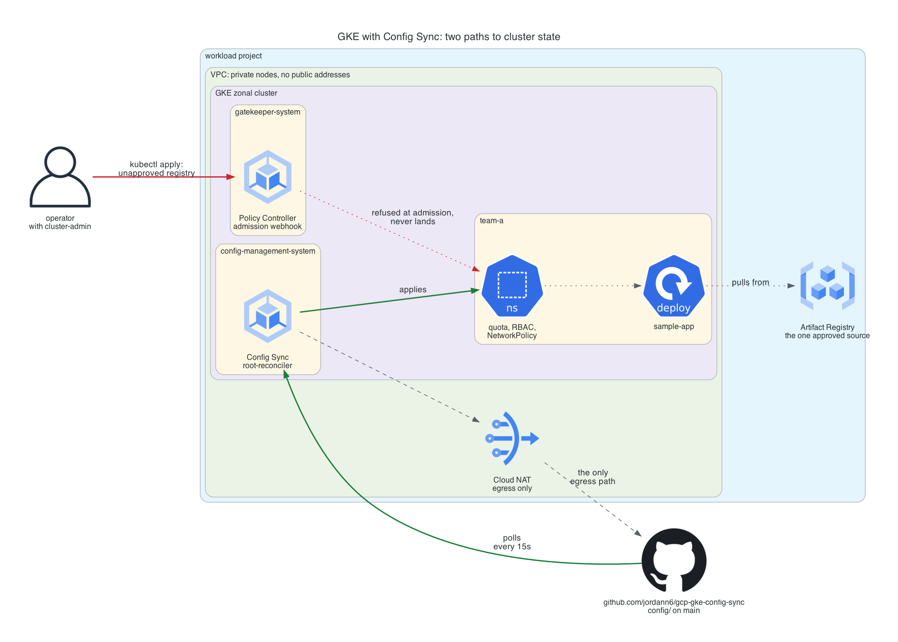

# GKE with Config Sync

Delete a ResourceQuota out of a namespace and it comes back fifteen seconds
later. Flip one boolean, delete it again, and the API server refuses the
request. Same person, same permission, same object, same command.

That difference is the whole point of this repo. A GitOps reconciler and an
admission controller are both described as "enforcing" configuration, and they
make different promises: one corrects the cluster after it is already wrong, the
other refuses to let it become wrong. Acts 2 and 3 of the demo are the same
deletion under each.



**Cost:** roughly $1 for a full deploy, demo, and destroy cycle. Standing cost
if left up is about $210 a month, and that is the number to pay attention to.
**Teardown:** one `terraform destroy`, no organization-scoped leftovers, but
read the note on the 30-day project deletion before rebuilding.

## The problem

Every Kubernetes cluster accumulates configuration nobody can account for. Not
because people are careless, but because `kubectl apply` is how the cluster is
operated, and a command run at 6pm to unblock a deploy leaves nothing behind
that says it happened. Six months later the cluster contains a RoleBinding that
matches no file, and the only way to find out whether it is load bearing is to
delete it and see who complains.

The usual fix is to put the manifests in Git. That is necessary and it is not
sufficient, because Git being the intended source of truth does not stop the API
server from accepting writes from anywhere else. A repo that describes what the
cluster is supposed to look like, next to a cluster that does not look like it,
is worse than no repo, because now there is a document people trust.

Two mechanisms close that gap and they are not the same mechanism.

**Reconciliation** runs a controller in the cluster that polls the repo, diffs
it against live state, and corrects the difference. Drift is possible and
temporary. The guarantee is eventual, and the window is however long the poll
interval is.

**Admission control** runs a webhook in front of the API server that refuses
writes. Drift is not corrected because it never happens. The guarantee is
immediate, and the cost is that the webhook is now in the path of every write,
including the ones you need during an incident.

This builds both, on one cluster, and shows the difference rather than asserting
it.

## What is here

A zonal GKE cluster with private nodes, running:

- **Config Sync**, reconciling `config/` from this repo every 15 seconds
- **Policy Controller**, with the full constraint template library installed
- **Three constraints**: two enforcing, one deliberately in dry run
- **A tenant namespace** with RBAC, a quota, a LimitRange, and default-deny
  NetworkPolicies, all of it declared in Git
- **A sample workload** that is deliberately in violation of the dry-run
  constraint, because a policy demo where nothing is wrong proves nothing

Terraform builds the cluster and turns the features on. It does not manage a
single object inside the cluster. That split is deliberate and it is the reason
a bad namespace change here is a `git revert` rather than a `terraform apply`.

### The licensing thing, because it changed

Config Sync and Policy Controller used to require a GKE Enterprise (formerly
Anthos) subscription, billed per vCPU per hour. That put them out of reach for
anything built to be torn down the same afternoon, and it is why most
self-directed learning material reaches for the open source installs instead.

In September 2025 Google dissolved the Enterprise tier. Fleets, Config Sync,
Policy Controller, and Connect Gateway moved into base GKE at no additional
cost. The only cluster charge is the flat $0.10 an hour control plane fee, and
one zonal cluster per billing account is covered by the $74.40 monthly credit.

The open source paths are now the worse option, not the cheaper one.
`kpt-config-sync` publishes no GitHub release assets, and the manifest bucket
its own documentation points at (`gs://config-management-release`) no longer
serves anonymous or ordinary authenticated callers, so the documented OSS
install is a dead link. Running upstream Gatekeeper instead of Policy Controller
means giving up the maintained template library and hand-wiring every constraint
template.

## The demo

    ./scripts/demo.sh all

Six acts. Acts 2 and 3 are the argument, and the rest is context for it.

**Act 1: the commit the cluster is running.** Config Sync reports a Git SHA in
`RootSync.status.sync.commit`, and the act asserts it equals the branch head.
This is the property that makes the rest worth doing: not that the config lives
in Git, which is just a file location, but that "what is deployed" has an answer
you can check against a repo instead of assembling from memory.

**Act 2: drift, corrected.** Delete `resourcequota/team-a-quota`. Nothing stops
you. The object is genuinely gone and the cluster genuinely does not match Git.
It comes back in about five seconds, not the fifteen the poll interval would
suggest: Config Sync holds a watch on the objects it manages, so a deletion is
observed rather than waited for, and `sync_wait_secs` is the ceiling on noticing
a change in Git rather than a change in the cluster. The act times it and then
says the uncomfortable part out loud: for those seconds the quota did not exist,
and any pod admitted in that window was admitted without it.

**Act 3: the same drift, refused.** Set `prevent_drift = true`, which installs
the Config Sync admission webhook, and run the identical delete. It is rejected.
The delete never reaches etcd, so there is no window to measure. One boolean is
the difference between a config management tool and a control.

**Act 4: a privileged container, and which controller catches it.** The pod is
refused, and not by the constraint you would expect. Pod Security Admission is
built into the API server and runs ahead of every validating webhook, so
`enforce: baseline` on the namespace rejects the pod and Gatekeeper is never
consulted. `deny-privileged-containers` is loaded and enforcing; it simply never
gets asked.

The act was originally written to assert that the denial would name the
constraint. It does not, and finding that out on a live cluster was worth more
than the assertion. The useful consequence: deleting the constraint entirely
would not change this act's output, which means this test cannot tell you
whether Policy Controller is working. Act 5 can.

**Act 5: an unapproved registry.** A pod pulling from Docker Hub is rejected by
`approved-image-sources`. Worth noticing that this is a refusal at write time,
not an `ImagePullBackOff` two minutes later. The image is never fetched.

**Act 6: what enforcing the third constraint would break.** `pin-images-to-digests`
is set to `dryrun`, so it admits everything and records violations. The act
reads them back and finds the sample app, which pulls `registry.k8s.io/pause` by
tag and is running right now. Promoting the constraint to `deny` is a one-word
diff, and doing it without reading this first is how a policy rollout takes down
a namespace on a Friday.

## Deploying it

Two layers. The bootstrap layer creates a seed project and a state bucket; the
root module creates everything else. They are separate because the root module
destroys its own project, and a state bucket inside it would be deleted by the
destroy that needs to write to it.

```bash
# 1. Seed project and remote state
cd bootstrap
cp terraform.tfvars.example terraform.tfvars   # org_id, billing_account
terraform init && terraform apply
terraform output backend_hcl                   # paste into ../terraform/backend.hcl

# 2. The cluster
cd ../terraform
cp backend.hcl.example backend.hcl             # from the output above
cp terraform.tfvars.example terraform.tfvars   # fill in, see below
terraform init -backend-config=backend.hcl
terraform apply

# 3. Point kubectl at it and wait for the first sync
./scripts/demo.sh env
```

Three values in `terraform.tfvars` need real input:

- `seed_project_id`, from the bootstrap output
- `authorized_ip_ranges`, your public IP as a /32 (`curl -s https://api.ipify.org`)
- `workload_name_suffix`, any 4 to 8 lowercase alphanumerics (`openssl rand -hex 3`)

If you forked this repo, also point `sync_repo` at your fork. The cluster
reconciles from whatever that URL says, not from your working copy, so anything
you have not pushed does not exist as far as the cluster is concerned.

Expect 15 to 20 minutes. The cluster itself is about 8, and the first Config
Sync reconcile is another 2 to 4 on top, because the fleet feature has to
install the reconciler before the reconciler can clone anything.

### If `terraform init` says the state bucket does not exist

It probably does exist. Check what your Application Default Credentials are
using as a quota project:

```bash
grep quota_project_id ~/.config/gcloud/application_default_credentials.json
```

ADC stores a quota project, `gcloud auth application-default login` sets it to
whatever project you were working in at the time, and it is sticky. The GCS
backend attaches it to every API call as `x-goog-user-project`. If that project
has since been deleted, the call comes back 404 "The requested project was not
found", and Terraform surfaces it as:

    Error: Failed to get existing workspaces: querying Cloud Storage failed:
    storage: bucket doesn't exist

Which names the wrong object entirely. The bucket is fine and readable; the
project being billed for the read is gone. This is easy to hit in this
portfolio specifically, because every build here ends by deleting its projects,
so ADC is routinely left pointing at a project that no longer exists.

```bash
gcloud auth application-default set-quota-project SEED_PROJECT_ID
```

Worth knowing that `gcloud storage ls` on the same bucket succeeds throughout,
because the gcloud CLI uses its own credentials rather than ADC. Two tools, two
credential paths, one of them broken, and the one that works is the one you
reach for to check.

## Cost

| | per hour | if left up for a month |
|---|---|---|
| GKE control plane, zonal | $0.10 | $73, normally covered by the $74.40 free credit |
| 2 x e2-standard-2 nodes | $0.134 | $98 |
| Cloud NAT gateway | $0.044 | $32 |
| 2 x 50GB pd-balanced | $0.014 | $10 |
| Artifact Registry (empty), logging, Config Sync, Policy Controller | $0 | $0 |
| **Total** | **~$0.29** | **~$210** |

An afternoon costs about a dollar. A cluster forgotten over a weekend costs
about fourteen, and one forgotten for a month costs real money, which is why
`scripts/destroy.sh` exists and why the node count is capped at five by a
variable validation.

Cloud NAT is the line item that looks removable and is not. Private nodes reach
Google APIs through Private Google Access without it, but they cannot reach
`github.com`, and this entire build is a reconciler polling `github.com`.
Removing the NAT does not slow the sync down, it stops it, and the symptom is a
RootSync reporting a Git error that reads like an authentication problem.

## Design notes

**Why the constraints use include lists, not exclude lists.** Every constraint
in `config/constraints` names `team-a` and `platform` explicitly. Excluding
system namespaces instead would look safer, and it is the direction that fails
badly: a namespace that appears next month is silently in scope, and a
constraint that blocks a GKE-managed system pod on a cluster where the webhook
is what is preventing you from fixing it is a bad afternoon.

**Why one constraint is a hand-written template.** The Policy Controller library
covers the common controls and does not cover requiring image digests.
`config/constraints/require-image-digest-template.yaml` is a ConstraintTemplate
with its own Rego, which is the pattern worth being able to write: the template
defines a new CRD and the policy language behind it, and the constraint
instantiates it with parameters. Templates are cluster vocabulary, constraints
are policy.

**Why there is no credential anywhere.** The repo is public and Config Sync
syncs it with `secret_type = "none"`, so there is nothing to hold and nothing to
rotate. A private repo needs either a Kubernetes Secret with a token or a Google
service account with Secret Manager access, both of which the cluster reads on
every sync. Public config with no secrets in it is the better default and it
forces the discipline that config carries no secrets. Workload Identity is on
for the same reason on the other side: pods get Google credentials through a
token exchange rather than a mounted key.

**The known weakness.** `approved-image-sources` allows the registry *host*,
`us-central1-docker.pkg.dev/`, rather than the specific repository path. The
full path contains a project ID with a random suffix that only Terraform knows,
and nothing under `config/` is templated. So the constraint approves any
Artifact Registry repository in that region, in any project, which is broader
than intended. The fix is Kustomize, which Config Sync runs automatically when
it finds a `kustomization.yaml`, with the project ID patched per environment.
That trades away the property that these files can be read literally, and it is
deliberately not done here. It is written down rather than quietly left.

**What CI is actually for.** Merging to `main` is the deploy. Config Sync
applies the branch head within 15 seconds, with no apply step, no plan to read,
and no gate between the merge button and the cluster. So the `config` job in
`.github/workflows/guardrails.yml` validates the manifests against the
Kubernetes schema with `-strict`, and a second step fails any constraint that
does not declare an `enforcementAction`, because the default is `deny` and a
constraint merged without thinking about that starts refusing writes
immediately.

## Tearing it down

    ./scripts/destroy.sh

One `terraform destroy`, about 12 to 15 minutes, nearly all of it the cluster.
Nothing here is organization-scoped, so unlike the perimeter builds in this
portfolio there is no leftover to hunt down at the org level.

Two things to know. The fleet membership is registered against the cluster's
resource link, so deleting the cluster by hand out from under Terraform leaves a
membership pointing at nothing that then needs a forced delete before that ID
can be reused. And project deletion is a 30-day soft delete: the project ID is
not free again until it completes, so rebuilding sooner means changing
`workload_name_suffix`.

The seed project is left standing on purpose. It is an empty project with one
small bucket, it costs nothing, and it holds the state history. The script
prints the two commands to remove it for good.

## Related

- [gcp-workload-identity-federation](https://github.com/jordann6/gcp-workload-identity-federation), the same token exchange from outside GCP
- [gcp-supply-chain-security](https://github.com/jordann6/gcp-supply-chain-security), signing and attestation, which is the artifact half of what this repo's registry constraint gestures at
- [gcp-zero-trust-access](https://github.com/jordann6/gcp-zero-trust-access), VPC Service Controls and IAP
- [platform-guardrails](https://github.com/jordann6/platform-guardrails), the shared CI gates this repo calls into
